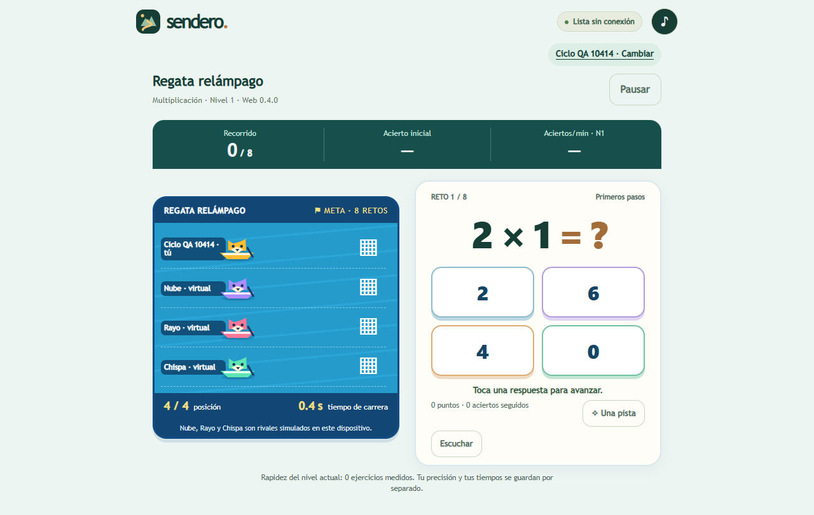
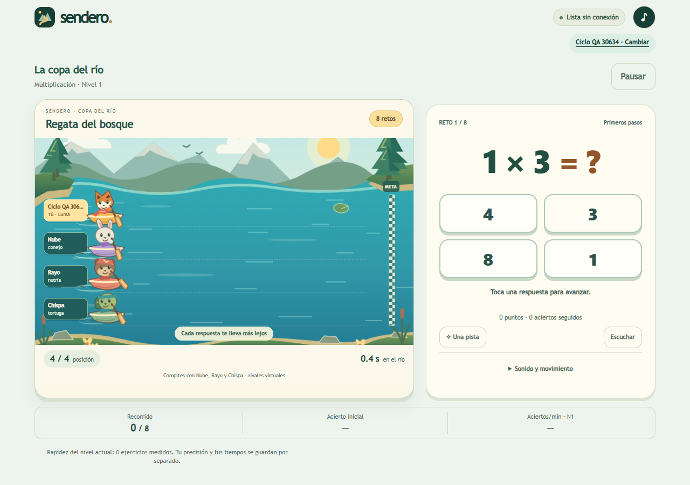

# Primera entrega del ciclo web: bosque ilustrado

13 de octubre de 2026. Estado: candidata para revisión. El autor eligió expresamente desarrollar el bosque ilustrado; la elección de dirección no equivale a aceptación de todas las rúbricas del ciclo. La fuente inicial es `76c3cb3b20676047fff1b56054cd451af43e1115` (0.4.0). La candidata usa la caché `sendero-0.4.0-regatta-candidate6`. No se ha publicado una nueva versión en la web pública.

## Cambio observable

La carrera incorpora un paisaje original con montañas, orillas, vegetación, agua y cielo en capas. Luma es una zorra; Nube, un conejo; Rayo, una nutria; y Chispa, una tortuga. Cada personaje tiene rasgos propios, además del color de su embarcación. Los remos, el balanceo, las estelas, las nubes y el agua tienen movimiento, con una opción de reducción de movimiento que se conserva al recargar.

La pregunta se actualiza conservando la escena en el documento. La respuesta correcta impulsa al jugador y produce una señal visual breve. El error mantiene la solución educativa y permite retomar la carrera. La posición y las respuestas permanecen visibles en los tamaños comprobados.

El sonido incluye motivos originales de salida, acierto, error, recuperación y llegada, más un ambiente discreto de río. Se sintetiza localmente, sin servicios externos ni archivos tomados de Arcademics. El silencio y los volúmenes de efectos y ambiente se guardan por perfil. La aritmética, los puntos, la adaptación y el modelo de velocidad de los NPC conservan sus reglas anteriores.

## Comparación visual

Versión inicial, con perfil sintético y viewport de 1280 × 800:

Primera candidata, con las mismas dimensiones de viewport:

Las operaciones concretas pueden diferir porque se usan perfiles de prueba distintos. Estas imágenes comparan composición, representación y legibilidad; no constituyen una comparación de resultados educativos.

## Comprobaciones

| Aspecto | Resultado | Alcance |
| --- | --- | --- |
| Pruebas Node | 32 aprobadas | Incluye la nueva comprobación de dependencias disponibles offline y coherencia de la caché |
| Carrera completa | Ocho retos, con un error y su corrección | Avance automático, nivel fijo, llegada y registro de 7/8 aciertos iniciales |
| Persistencia de escena | 7/7 cambios conservaron el mismo nodo y la misma instancia de animación | También se comprobó la continuidad al mostrar la corrección |
| Sonido | Cinco motivos renderizados; pico absoluto 0,08952 a volumen de efectos 0,65 | Render offline del sintetizador de producción; no es una evaluación auditiva ni un nivel de presión sonora |
| Silencio | Volumen cero produce señal nula; desactivar sonido corta efectos y río | Estado conservado al recargar |
| Preferencias | Efectos 0,35; río 0,10; movimiento reducido | Valores de prueba conservados tras recarga |
| Offline | Recarga y respuesta siguiente completadas sin red | Conservación de perfil y partida pendiente; entorno Chromium de prueba |
| Pausa | Tiempo de pausa excluido | Comparación del reloj persistido antes y después de una pausa controlada |
| Pantallas | 1280 × 800, 390 × 844, 360 × 640 y 854 × 480 | Cuatro respuestas y posición visibles, sin desbordamiento horizontal en los estados comprobados |
| Otros modos | Ocho retos completados en «A mi ritmo» y avance en razonamiento | Sin escena competitiva ni errores de ejecución en el recorrido |

Las cifras `responseMs` del registro automatizado son tiempos de ida y vuelta del controlador, no latencia física de respuesta ni una medición del percentil 95 previsto en el plan. La tasa de cuadros, la latencia con al menos 30 entradas, la revisión completa de contraste y el rendimiento en teléfono físico permanecen pendientes.

La corrección del indicador offline se acompaña de una prueba del grafo de módulos y hojas de estilo. Durante la comparación inicial, las dos copias bajo el mismo origen interferían con sus cachés; la comprobación definitiva se realizó después de reinstalar la caché de la candidata y sin reactivar la copia inicial. No se interpreta aquel fallo del montaje de comparación como un resultado de funcionamiento offline del producto final.

## Referencia de Arcademics y límites perceptivos

Se completó una carrera privada de Grand Prix con tres rivales informáticos y se observaron salida, error, recuperación, desplazamiento, llegada y resultados. Se conservaron una captura y el estado accesible de resultados como evidencia local. No se obtuvo una grabación audiovisual completa de Grand Prix ni una valoración auditiva comparada.

La referencia permitió observar continuidad entre escenario, vehículos, respuestas y carrera. Se conservaron la identidad del río y recursos originales de Sendero. No se incorporó código, imagen ni sonido de Arcademics al proyecto.

Las puntuaciones del autor para armonía cromática, composición, expresividad, mezcla sonora y jugabilidad siguen pendientes. No hay prueba con niños ni evidencia de aprendizaje. La próxima revisión debe juzgar una partida y una escucha completa, no sólo una imagen.

## Evidencia y continuidad

Las capturas de comparación se incluyen en este documento. Los resultados estructurados se conservan en `docs/qa-web-cycle1/verification.json`. La copia inicial de `web/` se conserva localmente en `qa-private/ciclo-web-20261013/baseline-web/`. Las grabaciones, capturas adicionales, muestra de audio, registros y manifiesto con SHA-256 se encuentran en `output/playwright/ciclo-web-20261013/`; estos archivos locales no se incorporan automáticamente al repositorio.

Los recorridos pueden repetirse con los scripts `qa-web-regatta-prepare.js`, `qa-web-regatta-visual.js`, `qa-web-regatta-settings.js`, `qa-web-regatta-layouts.js`, `qa-web-regatta-audio.js` y `qa-web-regatta-modes.js`. Se ejecutan con Playwright sobre un perfil sintético en un origen local; no usar el perfil real del autor. Ejecutar primero `prepare`, luego `visual`, `settings`, `layouts` y `audio`; para `modes`, volver a ejecutar `prepare` y obtener un perfil sin partida pendiente. La comparación con la copia inicial debe realizarse en otro origen o contexto aislado para evitar interferencia entre versiones del service worker.

El siguiente incremento aborda la calibración y variedad de rivales, adelantamientos y recuperación, junto con la revisión perceptiva de esta base. Los NPC aún conservan ritmos relativos fijos. Continúan pendientes los hitos y criterios finales de [PLAN-MEJORA-PROGRESIVA.md](PLAN-MEJORA-PROGRESIVA.md). APK y paquetes nativos quedan fuera del ciclo web actual.
