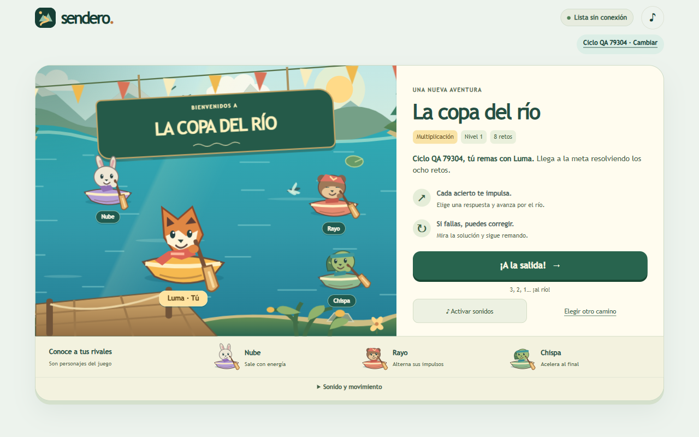
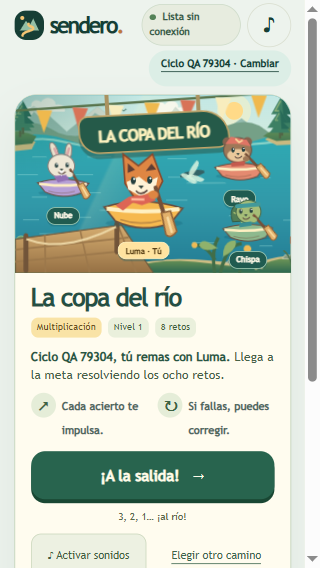
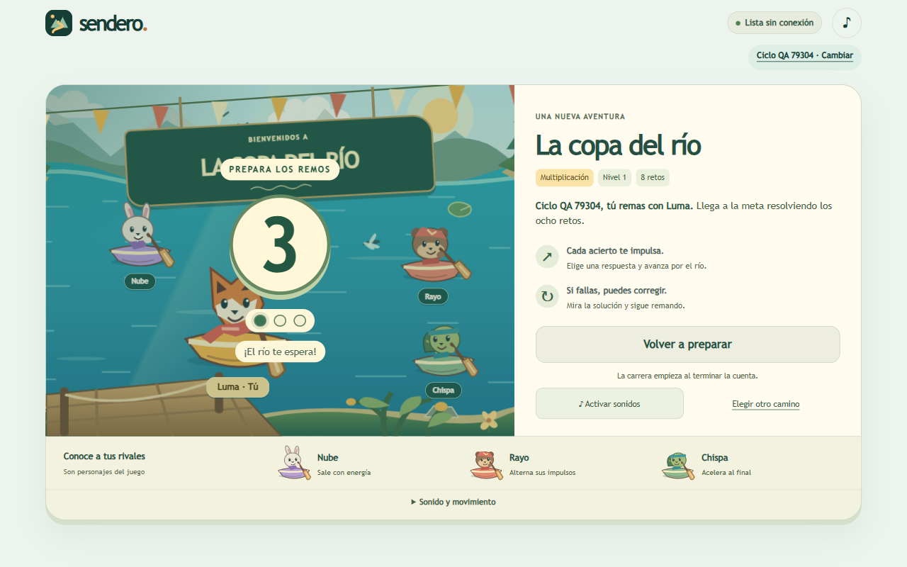

# Web 0.6.0: preparación y salida de La copa del río

13 de octubre de 2026. Cuarto incremento del ciclo web. La intervención completa el tramo de preparación y salida previsto en la jornada 14 y añade mediciones de rendimiento, revisión del contraste y una captura continua del audio del juego. El alcance autorizado incluye publicar después de conservar una copia local de la web anterior. La aceptación estética del ciclo continúa pendiente.

## Experiencia y dirección artística

Antes de comenzar se presenta una composición propia para la salida: paisaje del bosque, agua turquesa, muelle en primer plano, guirnaldas, cartel de la copa y cuatro personajes reconocibles. Luma ocupa el centro y se identifica como «Tú». Los rivales se presentan por nombre y personalidad de ritmo. La paleta verde, crema y dorado mantiene la identidad elegida por el autor. Banderines, remos, balanceo, parpadeo y una libélula aportan movimiento ambiental; las animaciones se desactivan con movimiento reducido.

La información de preparación se concentra en el objetivo de ocho retos, el impulso por acierto y la posibilidad de corregir. «¡A la salida!» inicia tres pulsos de 700 ms con número, indicadores visuales y un motivo sonoro breve; después se escucha el motivo de salida. La cuenta se puede cancelar y no expone todavía la primera operación. Con movimiento reducido, el inicio es directo. La composición móvil conserva la acción principal en la primera pantalla, incluso a 320 × 568 píxeles.

Los dibujos y motivos son originales, incluidos en el código bajo la licencia MIT del proyecto. Se extendió el sistema SVG existente; no se incorporaron imágenes, sonidos, fuentes remotas ni código de Arcademics. El nuevo parpadeo, muelle, guirnaldas y composición están en `race-start.js` y `race-start.css`; los motivos se sintetizan mediante Web Audio. No se añadió ninguna dependencia de ejecución.

## Referencia dentro de Grand Prix

Se inspeccionó nuevamente [Grand Prix Multiplication](https://www.arcademics.com/games/grand-prix) dentro del juego: sala privada con un jugador de prueba y tres participantes informáticos, preparación, cuenta y entrada a la pista. La inspección identifica decisiones de presentación observables: participantes antes de arrancar, una acción de inicio dominante, preparación explícita y transición hacia el primer ejercicio. Sendero adopta esos criterios de claridad con su identidad de regata.

La evidencia local comprende capturas de la preparación y del inicio y una grabación visual de aproximadamente siete segundos. Esta inspección no incluye una escucha comparada de Grand Prix ni permite declarar equivalencia estética o competitiva. Los archivos de referencia se mantienen en el expediente local; no forman parte de los recursos distribuidos del juego.

## Integridad del inicio y recuperación

Una carrera nueva se guarda como preparada; su semilla, rivales, nivel y preguntas permanecen fijos. La espera y la cuenta regresiva no consumen tiempo activo ni invalidan la primera respuesta. La fecha efectiva de inicio se establece al soltar la salida. Cancelar, recargar o salir durante la cuenta conserva la preparación. Cerrar sesión y volver a entrar conserva igualmente el primer reto sin marcarlo como interrumpido.

Las carreras de versiones anteriores y las carreras nuevas ya iniciadas se reanudan directamente. Cambiar de camino antes de empezar no solicita descartar respuestas inexistentes; una carrera iniciada mantiene su confirmación de abandono. Se corrigió la doble activación que podía iniciar y cancelar inmediatamente la cuenta: el botón de cancelación ignora el segundo clic y los primeros 300 ms; Escape cancela de inmediato.

## Verificaciones y límites de medida

Los resultados estructurados están en [browser-verification.json](qa-web-0.6.0/browser-verification.json), [performance.json](qa-web-0.6.0/performance.json), [audio.json](qa-web-0.6.0/audio.json) y [unit-tests.txt](qa-web-0.6.0/unit-tests.txt). Los recorridos utilizan perfiles sintéticos en navegadores aislados.

| Criterio | Resultado y alcance |
| --- | --- |
| Lógica y regresión | 42 pruebas Node aprobadas; comprobaciones nuevas de preparación, inicio idempotente, serialización y cuenta por tiempo transcurrido |
| Navegadores | Recorrido completo en Chrome 154 y Firefox 156 sobre Windows; Firefox se comprobó sin ventana visible tras una limitación de redimensionamiento de su ventana automatizada |
| Distribución | 1280 × 800, 390 × 844, 360 × 640, 320 × 568 y 854 × 480; acción de salida visible, sin desbordamiento horizontal y con altura de 48 o 52 px |
| Alias máximo | 24 caracteres mediante edición real del perfil; botón de salida termina a 517,45 px en viewport de 568 px de alto |
| Contraste | Mínimo 5,426:1 entre los textos y fondos sólidos examinados de la preparación; no es una certificación integral WCAG |
| Inicio por teclado | Enter inicia y el foco llega a la operación; Escape cancela la cuenta |
| Interrupciones | Recarga, navegación, cancelación y movimiento reducido; el cambio de visibilidad se ejercitó mediante un evento sintético porque el navegador automatizado no ocultaba la pestaña al alternar ventanas |
| Doble activación | Inicia una única sesión y no cancela inmediatamente la cuenta |
| Conservación | Espera, cancelación y reingreso al perfil no consumen tiempo de respuesta; se mantienen semilla y calibración |
| Otros modos | Práctica tranquila y razonamiento conservan sus recorridos independientes |
| Offline | Preparación guardada, recarga sin red, inicio y respuesta; repetición después de completar una carrera |

La confirmación de abandono se examinó instrumentando la llamada a `window.confirm` para devolver falso; se comprobó la solicitud y la conservación de la sesión, no el aspecto del diálogo nativo. La prueba con alias espera a que termine el guardado antes de navegar. Los errores del montaje de pruebas —redimensionamiento de Firefox con ventana, manejadores duplicados de diálogo y una primera captura sonora incompleta— se corrigieron antes de recoger la evidencia aceptada.

## Rendimiento

Se ejecutaron tres recorridos consecutivos de al menos 60 segundos, con respuestas, errores, correcciones, llegadas y nuevas salidas. Se registraron intervalos entre `requestAnimationFrame` y el tiempo desde la entrada hasta la segunda oportunidad de dibujado. El audio se mantuvo silenciado durante esta medición. El archivo de resultados registra navegador, procesadores lógicos, densidad y viewport.

Los percentiles 95 de intervalo entre cuadros fueron 16.8, 16.8, 16.9 ms. El intervalo máximo fue 50.5 ms y no se registraron intervalos superiores a 100 ms. En 55 entradas, el indicador de respuesta visual tuvo mediana 26.5 ms, percentil 95 32.6 ms y máximo 41.3 ms. Las tres muestras superaron el criterio de proyecto de 33,4 ms para cuadros y el conjunto de entradas el de 100 ms para respuesta. Se registraron 0 tareas largas; sus duraciones individuales se conservan en el JSON.

La latencia medida es un indicador interno del navegador; no mide el encendido físico de un píxel, el dispositivo de entrada ni la salida acústica. Estos resultados corresponden al equipo Windows de prueba y no se trasladan a un teléfono físico ni a todos los navegadores. Los fotogramas largos y las tareas largas se conservan en el registro.

## Sonido

Se capturó una carrera completa mediante una derivación PCM del grafo Web Audio del juego: activación, tres pulsos de cuenta, salida, acierto, adelantamiento, error, recuperación y llegada. La muestra dura 13,525 s a 48 kHz, con pico absoluto 0,09949, RMS 0,01208 y RMS cero en los últimos 300 ms tras silenciar. La duración del grafo fue 13,552 s; la diferencia corresponde al tamaño de los bloques de captura. No hubo saturación digital en esta muestra.

La captura utiliza un procesador sólo en el navegador de prueba, ausente del producto, y no accede al micrófono ni al audio del sistema. La primera vía mediante MediaRecorder presentó huecos de captura; sus archivos no se utilizan para juzgar la mezcla ni el silencio. La muestra válida es `output/playwright/ciclo-web-4-20261013/salida-y-carrera.wav` y su SHA-256 consta en el manifiesto local. El sintetizador no se modificó después de esa captura, salvo que el nuevo inicio incorpora el motivo de cuenta.

La existencia de señal, su temporización y el margen digital no demuestran calidad musical, sincronía percibida ni ausencia de fatiga. Sigue pendiente una escucha del autor en altavoces y auriculares, junto con la valoración del referente en condiciones comparables. Se entrega la muestra para hacer esa revisión sobre sonido real del juego.

## Publicación, respaldo y continuidad

La web 0.5.1 anterior queda preservada en `qa-private/public-web-backup-20261013-2218/`, con ZIP de la rama publicada, 30 archivos descargados, hashes y procedimiento de restauración. Los 30 coinciden con los objetos Git de `cb6faacd5fb30f45b30cf72d622fa694f10d7772`. Véase [backup-verification.json](qa-web-0.6.0/backup-verification.json). Este respaldo conserva el sitio; los perfiles permanecen en sus respectivos navegadores.

El estado efectivo del despliegue, los commits, la igualdad de los 32 archivos públicos y la conservación del perfil sintético durante la actualización se consignarán en `qa-web-0.6.0/publication.json` al publicar. En esta revisión previa, la web pública sigue en 0.5.1.

La jornada 14 queda comprobada técnicamente como arco de preparación, salida, desarrollo, llegada y repetición. La calidad perceptiva continúa como candidata: faltan puntuaciones del autor, observación de tareas con una persona no familiarizada y prueba física en teléfono. No se declara paridad con Arcademics ni preferencia infantil demostrada. Android y Windows distribuidos permanecen en 0.4.0.

## Reproducción y siguiente intervención

Ejecutar `npm test` y servir `web/` en un origen local. Con Playwright CLI y un navegador aislado, ejecutar `qa-web-regatta-prepare.js` antes de `qa-web-start.js`; después se pueden ejecutar `qa-web-start-accessibility.js` y `qa-web-start-performance.js`. Crear otro perfil sintético para `qa-web-start-continuity.js`, `qa-web-start-audio.js` o `qa-web-regatta-modes.js`. La prueba de actualización exige ejecutar `qa-web-start-upgrade-prepare.js` en la web 0.5.1 antes del despliegue y `qa-web-start-upgrade-check.js` en ese mismo contexto después.

La siguiente intervención debe concentrarse en la revisión audiovisual de una partida completa y la corrección del defecto perceptivo dominante, manteniendo la dirección del bosque. La preparación ya está implementada; no volver a planificarla como ausente. El teléfono físico, la escucha comparada y las tareas observadas siguen siendo comprobaciones específicas pendientes, no resultados inferibles de estas pruebas.
