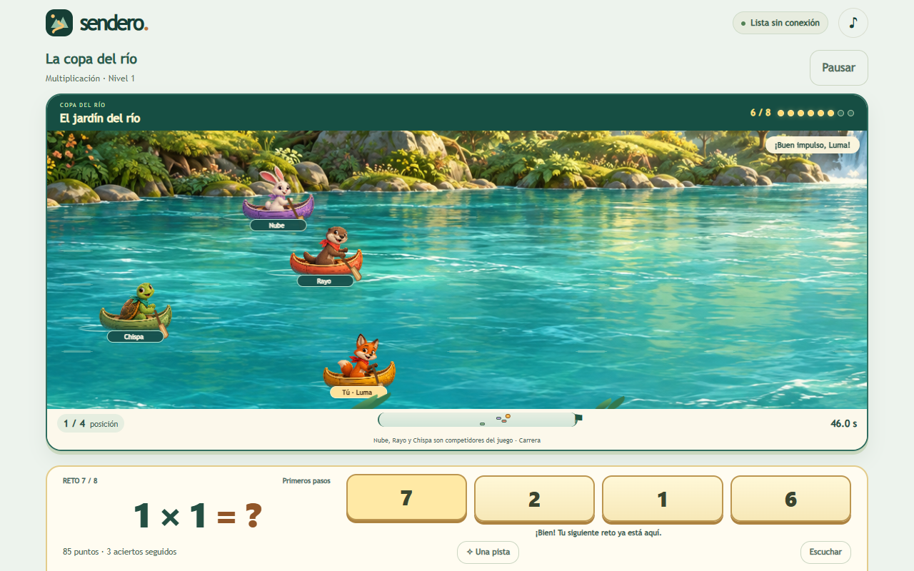
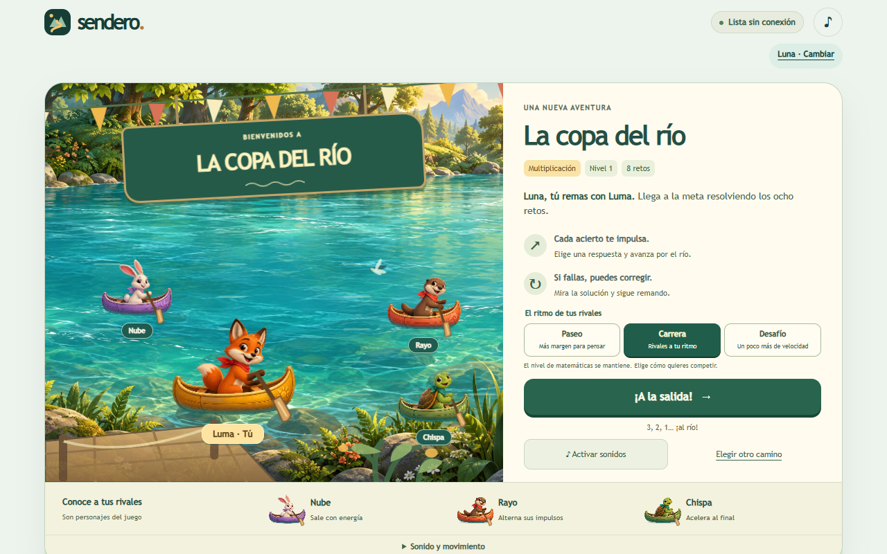
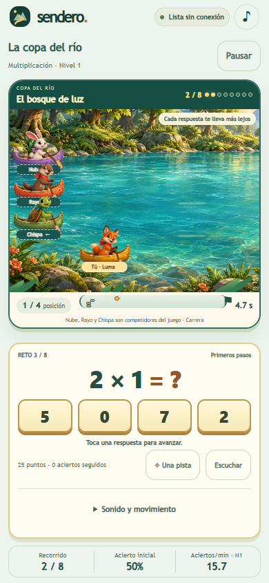

# Web 0.7.0: arte y movimiento de La copa del río

13 de octubre de 2026, Chihuahua. Quinto incremento web. La intervención renueva cromática, materiales, personajes, movimiento del jugador y entorno, presentación del reto y calibración de rivales. La revisión sonora queda reservada para otra intervención: `web/race-audio.js` coincide con la fuente de partida. Android y Windows permanecen en 0.4.0.

## Resultado visible y límites de la comparación

Sendero pasa de una escena vectorial fija, con figuras pequeñas y avance por saltos, a un panorama ilustrado con luz, vegetación y agua texturizada, cuatro personajes de siluetas y materiales distintos, remos, balanceo, estelas y salpicaduras. La cámara acompaña a Luma; fondo, reflejos y primer plano se desplazan a velocidades distintas. La operación y las cuatro respuestas ocupan una consola inferior compacta. Preparación y llegada utilizan los mismos recursos artísticos.

El [análisis comparativo](ANALISIS-ARCADEMICS-WEB-0.7.0.md) documenta dieciséis factores, una partida privada completa de Grand Prix y la línea base 0.6.0. La mejora material frente a Sendero anterior es visible; la superioridad general frente a Arcademics no queda demostrada. El referente conserva mayor variedad geométrica del circuito y competición humana. No se han observado preferencias ni resultados educativos de niños.

Los recursos se generaron con `image_gen` integrado, modo `built-in`. Los [prompts y la procedencia](ARTE-RIO-0.7.0.md) identifican los PNG originales y su uso como atlas CSS. No se incorporan recursos de Arcademics. Las ilustraciones suman 4.186.153 bytes, aproximadamente 4,19 MB decimales: la descarga inicial aumenta respecto de la versión vectorial. Ambas se almacenan para jugar sin conexión. No se añade una dependencia de ejecución ni un servicio externo.

## Movimiento y competencia

La distancia ganada sigue siendo un octavo por acierto. Un modelo de amortiguación crítica presenta el impulso mediante aceleración y desaceleración continuas, preserva velocidad entre respuestas y no concede avance por esperar o equivocarse. El minimapa y los indicadores laterales permiten interpretar a los rivales que quedan fuera del encuadre. La posición durante el recorrido corresponde a la representación; el resultado final conserva la comparación de tiempos exactos.

Paseo, Carrera y Desafío se eligen antes de salir. Cambiar de ritmo conserva identificador, semilla, nivel y preguntas. Los rivales quedan fijados durante la carrera; la adaptación de su referencia ocurre al preparar una nueva. La nueva calibración usa el tiempo activo hasta resolver correctamente e incluye correcciones. Excluye ayudas, interrupciones y datos inválidos, distingue contenido y nivel y deja de interpretar una respuesta errónea rápida como fluidez. Los protocolos antiguos siguen reproduciendo sus trayectorias originales.

La [matriz reproducible de rivales](qa-web-0.7.0/rivals-matrix.json) evalúa 4.800 configuraciones —cuatro contenidos, cuatro niveles, tres ritmos y cien semillas— y 24.000 llegadas simuladas. A velocidad de referencia se puede ganar Paseo y Carrera en todas las configuraciones; una reducción del 10 % del tiempo permite ganar Desafío. La matriz incluye ritmo lento y una corrección con tiempo adicional. Son escenarios sintéticos, no datos de rendimiento infantil.

## Verificación técnica y visual

Pasaron 47 pruebas Node. Cubren integridad educativa y de informes, persistencia y respaldo, adaptación, calibración, trayectorias históricas, invariancia del movimiento a 30/60/120 cuadros por segundo y disponibilidad offline de módulos, estilos e ilustraciones. Las pruebas no asignan puntuaciones de atractivo.

Los recorridos de Chromium y Firefox completaron preparación, elección de intensidad, cancelación de salida, acierto, error y corrección, pausa, recarga, carrera completa offline y movimiento reducido. No se registraron errores de aplicación en esas ejecuciones. La simulación de pestaña oculta está identificada como evento sintético, no como observación de suspensión física del dispositivo.

Las cinco configuraciones de viewport fueron 1280 × 800, 390 × 844, 360 × 640, 320 × 568 y 854 × 480. La salida y las cuatro respuestas permanecieron visibles sin desplazamiento horizontal, con dimensiones táctiles de al menos 44 píxeles. Se revisaron las capturas y se corrigieron recorte del atlas, bosque oculto, superposición de rótulos y respuestas cortadas en horizontal. La comprobación de un alias de 24 caracteres conservó la salida en la primera vista.

El contraste mínimo de los textos funcionales muestreados en preparación fue 5,43:1, incluidos los nuevos selectores de ritmo. Es una comprobación acotada, no una certificación global WCAG. La práctica tranquila y el razonamiento completaron sus recorridos de regresión sin introducir competición. La actualización pública se comprueba por separado con una carrera de protocolo 2 y un historial no vacío.

## Rendimiento: medida y alcance

En Chromium sin interfaz visible, a 1280 × 800, se registraron tres carreras de más de 64 segundos y otras dos más breves. El p95 del intervalo entre cuadros fue de 17,0–17,1 ms. Sobre cuarenta respuestas, la demora entre el evento de pulsación y el siguiente cuadro con la señal de avance actualizada tuvo mediana de 11,8 ms, p95 de 20,3 ms y máximo de 28,2 ms. Esta medida usa callbacks de animación; no mide la latencia óptica real de una pantalla ni representa un teléfono físico.

La prueba inicial en una ventana de Chromium suspendida por oclusión produjo intervalos cercanos a un segundo y se excluyó del benchmark. No se atribuye ese resultado al juego. En Firefox, la muestra breve inicial tuvo p95 cercano a 50 ms; una muestra posterior de escena estable dio 21,44 ms. La carrera sostenida de 64,30 s registró 3.473 intervalos, mediana de 16,66 ms y p95 de 33,32 ms; sus ocho pulsaciones tuvieron p95 de 15 ms. Se conservan todos los resultados, sin seleccionar solo el favorable. La muestra sostenida está en `qa-web-0.7.0/performance-firefox.json` y debe leerse junto a la muestra de arranque. No se garantiza la misma fluidez en todos los navegadores y dispositivos.

Las optimizaciones evitan reconstruir la escena entre preguntas, usan transformaciones para barcos, cámara y minimapa, actualizan rótulos solo cuando cambian y limitan las propiedades variables al elemento afectado. El movimiento reducido elimina desplazamiento ambiental, balanceo y remada, y actualiza directamente las posiciones.

## Respaldo y promoción

El respaldo previo de 0.6.0 se conserva en `qa-private/public-web-backup-20261014-0015/`: ZIP íntegro, 32 archivos públicos, hashes y `RESTORE.txt`. Se verificaron CRC del ZIP, SHA-256 del archivo y coincidencia de las descargas con `gh-pages` en `176cd61ae9ba4dee65a2aafe198d5fdb2decc32a`. Este respaldo corresponde a la web distribuida; los perfiles siguen residiendo en cada navegador.

La web 0.7.0 está publicada y verificada: los 36 archivos HTTP coinciden por SHA-256 con la fuente `0bbd14f1057031336813729295e763425885e170`; el despliegue es `1a1246e3431640a6612018271178230fc463f92b` y Pages `38494559976` terminó satisfactoriamente. En el perfil sintético de prueba se conservaron historial, intentos, semilla, cadencia y tiempos de llegada de la carrera pendiente 0.6.0 de protocolo 2. Se completó esa carrera, se abrió una nueva de protocolo 3 y se verificó respuesta e ilustraciones sin conexión. El estado definitivo se documenta en `qa-web-0.7.0/publication.json` y `upgrade.json`. Las capturas completas y vídeos se conservan localmente bajo `output/playwright/ciclo-web-5-20261014/`; los informes y hashes aceptados están en `qa-web-0.7.0/`.

La aceptación perceptiva sigue abierta a la valoración del autor y a observación de usuarios destinatarios. La riqueza visual, la posibilidad matemática de victoria y la ausencia de fallos detectados son propiedades diferentes; ninguna sustituye por sí sola a las otras.
